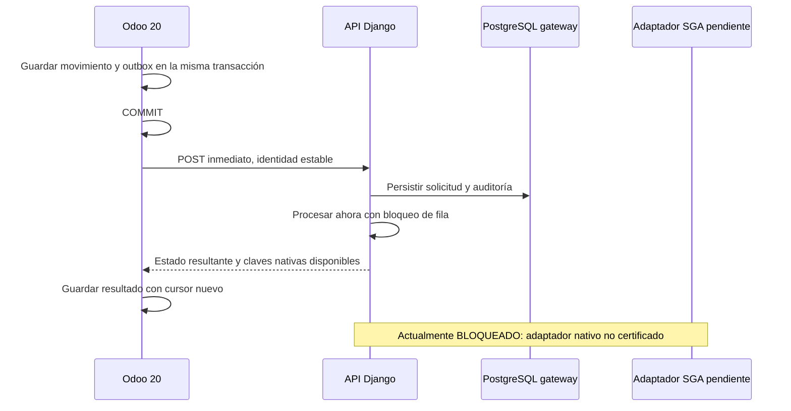

# Arquitectura del gateway

La aplicación usa Django 5.2 LTS, REST Framework, Gunicorn y PostgreSQL 16.
La entrega normal es una llamada inmediata después del commit de Odoo. La API
persiste primero la solicitud y luego la procesa durante esa misma petición.
El estado vuelve en la respuesta HTTP y se guarda en Odoo sin esperar un cron.
Los botones comerciales que generarán esos eventos todavía deben implementarse.

El callback posterior al commit evita publicar un movimiento que después se
revierta en Odoo. Utiliza un cursor nuevo y conserva solo identificadores
primitivos del origen. Si el proceso cae entre el commit y la llamada, la
bandeja de salida conserva la solicitud. Si pierde una respuesta, el reenvío
mantiene la identidad de operación y revisión. No existe una transacción
distribuida entre las tres bases.

## Recuperación

La cola persistente protege frente a fallos; no añade una espera programada
al camino normal. No se necesita Redis para conservar las solicitudes.

- Worker Django: recupera solicitudes que quedaron `EN_COLA` al menos 30 segundos
  por una interrupción entre persistencia y procesamiento inmediato. Toma filas
  con bloqueo y `skip_locked`; el envío normal no espera ese plazo.
- Cron Odoo: opcional y desactivado. Cada cinco minutos recupera comunicaciones
  sin confirmar que llevan al menos cinco minutos sin actualizarse y consulta
  resultados pendientes. También existe recuperación manual desde la bandeja.
- Un timeout conserva `EN_COLA / GATEWAY_CONNECTION_UNCONFIRMED`; no confirma que
  SGA haya aplicado ni que haya rechazado la operación.
- Un resultado nativo desconocido no se reintenta como una nueva aplicación.
  Si SGA confirmó y falla el espejo Odoo, se repara solamente el espejo.

Los estados y 18 acciones están definidos en `contracts/v1`. El contrato separa
solicitud recibida, resultado nativo confirmado y resultado conciliado.
Actualmente están implementadas recepción, procesamiento inmediato hasta
bloqueo preventivo, lectura y reintento autorizado de estados seguros.
La transición a Bloqueado y sus eventos se confirman en una transacción local,
sin efectos externos. El adaptador SGA sigue sin implementar.

## Eventos originados en SGA

El cambio de despacho, factura o inventario hecho por un usuario en SGA también
necesita un emisor después de su confirmación nativa para llegar al gateway y
actualizar Odoo inmediatamente. Esa ruta aún no está implementada. Hace falta
certificar un punto de emisión en SGA o una captura de cambios con garantías de
transacción. El cron de Odoo no convierte cambios arbitrarios de MySQL en eventos.
No se instalan triggers ni se activa captura en el servidor SGA en esta entrega.

La base del gateway no es la base de Odoo ni la de SGA. Sus migraciones no
modifican estas últimas. El repositorio de código no contiene adquisiciones
internas del análisis de SGA; sus reglas deben validarse en el entorno privado.

## Persistencia

- `gateway_postgres`: volumen nombrado con operaciones, eventos y migraciones.
- Configuración cifrada: repositorio privado independiente.
- Identidad age: canal independiente y fuera de Git.
- Secretos runtime: directorio externo con permisos restrictivos, ignorado.
- Respaldos: archivos cifrados externos, no versionados en Git.

Compose monta secretos por archivo. En Compose local son montajes de archivos;
no equivalen a un almacén de secretos cifrado en memoria. Cada servicio recibe
los archivos necesarios y la aplicación ejecuta sin root, sin capacidades y
con sistema de archivos de solo lectura.

Referencias: [commit y rollback de Odoo 20](https://github.com/odoo/odoo/blob/20.0/odoo/sql_db.py),
[Django LTS](https://www.djangoproject.com/download/),
[secretos Compose](https://docs.docker.com/compose/how-tos/use-secrets/) y
[age](https://github.com/FiloSottile/age).
