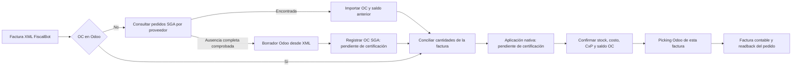

# Compras SGA ↔ FiscalBot: contrato y estado

SGA sigue siendo la fuente de costo, precio efectivo e inventario. La recepción
se identifica por factura, no por el total de la OC. Los pedidos sirven para
conservar autorización, cantidades solicitadas y saldos parciales.

La decisión del usuario es operar todo este circuito en **CRC**. Odoo consulta
SGA y envía las altas, ingresos y propuestas de precio al gateway; el efecto
se confirma con el resultado nativo antes de completar el espejo Odoo. La
decisión de moneda no activa el escritor pendiente ni cambia por sí sola la
moneda contable o los asientos de una compañía.

## Componentes entregados

| Componente | Capacidad | Estado |
| --- | --- | --- |
| `purchase_source.py` | Pedidos y líneas, cantidades mayor/detalle, banderas, moneda explícita, checksum y cursor | Implementado, SELECT solamente |
| `purchase_replenishment.py` | Listado bajo mínimo, clasificación ABC almacenada, ranking y proveedor por prioridad inequívoca | Implementado como lectura revisable |
| `purchase_effects_contract.py` | Contrato 2 de ingresos/precios: identidad, asignaciones, fuente fiscal, CRC, CxP y resultados nativos | Implementado; no ejecuta efectos |
| `purchase_exchange.py` | Canal inverso autenticado existente, fuente/aplicación fijas, límites de respuesta | Optativo; apagado por defecto |
| Addon Odoo `sga_gateway_purchase_flow` | Buscar/importar, recepciones por XML, notificaciones y reparación del espejo | Pruebas ORM; apagado por defecto |
| Escritor nativo de pedidos/ingresos/precios/reversas | Aplicación completa con reglas y transacción SGA | Pendiente de certificación e implementación |
| Barrido continuo de todas las OC en ambos sentidos | Detección de altas/ediciones/cierres y conflictos | Pendiente |

## Evidencia y límites comprobados

Se compararon cinco OC, cinco recibos y sus datos relacionados mediante una cuenta
SELECT y snapshot consistente. Los datos privados se conservan fuera del repo.
Existen recibos con `RecibidoCompleto=1` y líneas `Actualizado=1` que tienen
`Recibido=0`, `NoRecibido=1`: esos indicadores no prueban una entrada física.

Los filtros nativos para existencias y valoración difieren entre consultas. Las
diferencias de CxP acumulada frente a detalle muestran que falta recuperar la regla
de redondeo; no debe aplicarse igualdad literal entre ambos importes. La muestra
actual usa factor 1: no certifica cajas/detalle. No se dedujo el costo promedio
restando dos snapshots ni se sustituyó por una fórmula genérica.

Recalculo incluye modificaciones amplias y limpieza de CxP. No debe ejecutarse en
producción para compensar escrituras incompletas del gateway. Tampoco se asignan
Pedido/Recibo mediante `MAX+1`: el contador de artículos no prueba esos procesos.

REA 6.8.0 quedó instalado en un directorio propio del Windows de investigación,
con Node 24.22.1 verificado. La inspección `inspect_desktop_application` retuvo
Evidence `ev_0d9737357ae86d468de6072b365e0c26ba901d1f52598198585815ed78cbfbcd`.
Es inventario de archivos, no ejecución ni recuperación de VBA.

Los hashes actuales difieren del corpus anterior para SGAProg y PGBiblio; Compart
y Recalc coinciden. El 19 de noviembre se verificó la cuenta autorizada de Access
con una copia privada del grupo de trabajo correcto: DAO leyó **211 consultas**
seleccionadas de SGAProg (173), Recalc (37) y PGBiblio (1), sin errores. Sus SQL
coinciden con el corpus anterior al normalizar espacios; esto incluye
`Ver Lista ArtsServs Debajo Minimo`. La denegación 3110 observada con el grupo de
trabajo incorrecto queda resuelta. La adquisición usó acceso compartido y la
tarea temporal autorizada se eliminó al terminar. No se exportan credenciales,
el grupo de trabajo ni consultas privadas a Git.

La coincidencia de las consultas no certifica los cuerpos VBA compilados ni sus
transacciones. Falta una empresa de prueba completamente aislada, incluidos los
accesos indirectos de PGData, para contrastar los procedimientos y aplicar
transacciones sin afectar la operación. No se ejecutaron consultas de negocio,
macros de aplicación ni Recalculo durante la lectura de definiciones.

La revisión autorizada de las tres clases propias de la aplicación Java de
consulta de precios comprobó que sus copias coinciden con los archivos
desplegados. Esas clases consultan MySQL mediante SELECT preparados; no contienen
un ejecutor de ingresos, costos o publicación de precios. Java seguía activo y
no se reinició. El código y las evidencias adquiridas permanecen privados, fuera
de Git. El alcance no incluye JSP ni bibliotecas. La escritura del gateway sigue
requiriendo certificar las transacciones SGA, la auditoría/historial y la detección
de cambios concurrentes en el precio origen.

## Reposición

El listado bajo mínimo compara
`CantDisponible + CantDisponibleDet / NumeroUnidades < CantMin`, conserva la
selección Trabajado/Retenido y ordena por Ranking. ABC es la clasificación
almacenada; no se recomputa. Requiere configurar esas selecciones y verificar la
consulta contra la versión instalada; mientras tanto los resultados son revisables.

El automático original tiene otra existencia: Facturable, pedidos pendientes y
BackOrder, aplica `Int`, usa `<= mínimo` y calcula hasta máximo. Por eso
`minmax_auto` devuelve bloqueo mientras esas funciones no estén verificadas.
El listado bajo mínimo no inventa una cantidad sugerida.

## Transporte, integridad y configuración

El mismo servicio de intercambio sale de Linux hacia Odoo por HTTPS. No requiere
abrir un puerto público ni exponer Access/MySQL. `SGA_PURCHASE_BRIDGE_FILE` apunta
a una configuración local privada (ejemplo en `deploy/purchase-bridge.example.json`).
Comparte la fuente SELECT ya restringida; la cuenta de artículos y Java siguen
independientes. La opción `enabled` no concede derechos de escritura.

El ejemplo conserva `enabled=false` y fija `national_currency_code="¢"` por la
decisión explícita de trabajar en CRC. Es el código nativo de moneda nacional,
homologado a `CRC` mediante `currency_map`. El mapa conserva `$`→`USD` para
identificar datos de lectura históricos: no habilita ingresos ni precios en USD,
ni convierte importes por cambiar su etiqueta. Las selecciones de reposición
siguen sin predeterminarse y la verificación de la consulta sigue en falso.

Todas las solicitudes fijan `contract`, `action`, `operation_id`, `application_id`
y `source_instance`. Las lecturas `purchase.search`, `purchase.discover` y
`purchase.replenish`, y el registro de OC `purchase.upsert`, usan `contract=1`.
`purchase.receive`, `price.lookup` y `price.publish` utilizan `contract=2`.
El UUID es el del mensaje inmutable.
Los ingresos y precios incluyen `request_checksum` del bloque correspondiente;
una confirmación histórica de versión 1 no confirma una solicitud de versión 2.
Los resultados exitosos
se conservan en GatewayInbox: una respuesta perdida no repite un efecto. Un bloqueo
de capacidad se comunica sin convertirlo en recibo nativo terminal. Una excepción
de commit desconocido conserva la solicitud pendiente para reconciliar la misma
identidad; nunca se transforma en rechazo/ausencia ni en otra operación.

La búsqueda distingue una ausencia comprobada de una página incompleta, moneda
sin resolver, fallo de red y conflicto de datos. Las respuestas se acotan al límite
del endpoint Odoo; se recortan solo entre órdenes completas y conservan cursor.
Un pedido individual demasiado grande exige otro contrato; no se trunca su detalle.

La consulta `purchase.discover` devuelve pedidos elegibles en CRC con cantidades
pendientes y unidades compatibles con la importación. El filtro `scope` contiene `vendor_code`, `vendor_tax_id`,
`order_id` y `article_ids`. El código de proveedor tiene prioridad y se usa
solo uno de los dos identificadores de proveedor. La lista de artículos acepta
hasta 100 identificadores distintos, ordenados de menor a mayor, y encuentra
pedidos con cualquiera de esos artículos pendiente. Sin filtros devuelve los
pedidos más recientes. `limit` admite 1 a 100 pedidos.

Cada fila ofrece número, proveedor, fecha, moneda y un resumen de los artículos
pendientes que coinciden. Los conjuntos `article_ids` y `pending_article_ids`
permiten comprobar la homologación en Odoo de todas las líneas del pedido.
Si `has_more` es verdadero, pasar `cursor_after` como
`after` para continuar, incluso si una página quedó vacía tras validar los
pedidos. La importación requiere seleccionar un candidato y volver a consultar
el pedido exacto mediante `purchase.search`.

## Contrato fiscal 2 y aplicación nativa pendiente

`purchase.receive` conserva la clave fiscal, SHA256 del XML original, emisión con
zona horaria, fecha física de recepción y condiciones de pago con origen del
vencimiento. Exige `currency=CRC`, `source_currency=CRC` y tipo de cambio efectivo
1. `source_exchange_rate=null` conserva la ausencia de ese dato en el XML; si se
declara, debe ser 1. Las asignaciones enlazan línea XML, artículo, presentación,
factor, cantidad y costo neto con la línea nativa de OC. El costo distribuido
se concilia con el subtotal XML mediante la precisión nativa de cuatro decimales;
no se reemplaza por la cotización de la OC ni por un promedio calculado localmente.

El bloque fiscal transporta CABYS, descuentos, impuestos, exoneraciones, impuesto
asumido, IVA devuelto, promociones, cargos y servicios sin inventario. Conserva
fragmentos XML de descuentos, exoneraciones y otros cargos para mantener su
fuente. Validar y transportar esos datos no demuestra que SGA los aplique: el
límite de ejecución bloquea impuestos, descuentos, promociones, cargos/IVA
devuelto, crédito, líneas sin stock y particiones con condiciones nativas
incompatibles hasta certificar cada caso. La candidata ordinaria restante es
mercancía neta de contado en CRC; también requiere un ejecutor nativo certificado.
Las solicitudes de efectos versión 1 quedan bloqueadas para nueva ejecución.

`price.lookup` acepta `scope` con `level: 1` y de uno a 50 `article_ids` únicos.
Devuelve una fila por ID, en el orden solicitado. Cada fila contiene la moneda,
el tipo de cambio, el IVA, el precio neto normal, la revisión `native_checksum`
y la disponibilidad y motivo de bloqueo de la publicación. Para margen fijo,
el precio neto Normal se calcula con el costo unitario al detalle y la suma
del margen y la variación minorista, redondeado al centavo de CRC. La consulta
de ventas de SGA confirmó ese cálculo en artículos cuyo sugerido guardado difería.

`price.publish` versión 2 publica el detalle Normal nivel 1 en CRC, con
`exchange_rate=1`, cuatro decimales y el IVA de SGA. La aprobación congela en
el bloque `price` el `expected_native_checksum` obtenido de `price.lookup`.
Una revisión distinta produce `SGA_PRICE_SOURCE_CHANGED`. La confirmación
incluye `effective_price` y `native_price`, la fila de lectura con su nueva
revisión para la siguiente aprobación.

El escritor opcional usa `price_writer_file` y una cuenta independiente. Para
`crc_normal_fixed_margin_retail`, ajusta la variación al detalle y el sugerido
que le corresponde. El margen principal y el esquema de cálculo conservan su
configuración. Publica precios al centavo y verifica el precio calculado antes
de confirmar la transacción. El perfil separado `crc_normal_maintain_retail`
requiere certificar esa política de venta en SGA para usarlo. La cuenta tiene
los `SELECT` por columna declarados en `purchase_price_source.py`, `UPDATE`
por columna en `artsservsprecios` y `SELECT`/`INSERT` del diario
`retail_price_application` para registrar una sola confirmación por operación.

La transacción nativa deberá deduplicar por operación y factura, asignar consecutivos
con el mecanismo SGA, guardar recibo/CxP, modificar existencias y valoración,
actualizar agregados/saldos de OC y verificar el commit. La confirmación tendrá
identidades nativas, cantidades y costos efectivos por asignación y obligación CxP
única. La confirmación 2 incluye también digest fiscal, fecha física y condiciones
CxP coincidentes. Unas banderas `true` en JSON no prueban estos efectos. El espejo
Odoo inicial admite un recibo por factura/operación, mercancía AVCO sin trazabilidad,
cantidades enteras y factor 1; ampliar presentaciones o particiones exige otro
alcance certificado.

La conexión Odoo debe homologar CRC tanto para SGA como para la moneda contable.
Si una compañía aún conserva otra moneda, el ingreso se bloquea; no se copian
CRC como si fueran USD ni se modifica la contabilidad desde este ejemplo. La
lectura de OC es independiente de habilitar los efectos financieros. No se ha
añadido un escritor SQL/Jet ni el barrido continuo de órdenes, y `enabled=false`
sigue siendo el estado de despliegue de referencia.
