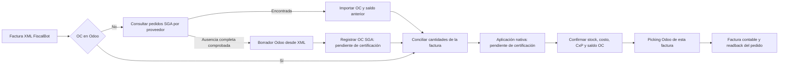

# Compras SGA ↔ FiscalBot: contrato y estado

SGA sigue siendo la fuente de costo, precio efectivo e inventario. La recepción
se identifica por factura, no por el total de la OC. Los pedidos sirven para
conservar autorización, cantidades solicitadas y saldos parciales.

## Componentes entregados

| Componente | Capacidad | Estado |
| --- | --- | --- |
| `purchase_source.py` | Pedidos y líneas, cantidades mayor/detalle, banderas, moneda explícita, checksum y cursor | Implementado, SELECT solamente |
| `purchase_replenishment.py` | Listado bajo mínimo, clasificación ABC almacenada, ranking y proveedor por prioridad inequívoca | Implementado como lectura revisable |
| `purchase_effects_contract.py` | Valida identidad, cantidades, costos, obligación CxP y resultados | Implementado; no ejecuta efectos |
| `purchase_exchange.py` | Canal inverso autenticado existente, fuente/aplicación fijas, límites de respuesta | Optativo; apagado por defecto |
| Addon Odoo `sga_gateway_purchase_flow` | Buscar/importar, recepciones por XML, notificaciones y reparación del espejo | Pruebas ORM; apagado por defecto |
| Escritor nativo de pedidos/ingresos/precios/reversas | Aplicación completa con reglas y transacción SGA | Pendiente de certificación e implementación |
| Barrido continuo de todas las OC en ambos sentidos | Detección de altas/ediciones/cierres y conflictos | Pendiente |

## Evidencia y límites comprobados

Se compararon cinco OC, cinco recibos y sus datos relacionados mediante una cuenta
SELECT y snapshot consistente. Los datos privados se conservan fuera del repo.
Existen recibos con `RecibidoCompleto=1` y líneas `Actualizado=1` que tienen
`Recibido=0`, `NoRecibido=1`: esos indicadores no prueban una entrada física.

Los filtros nativos para existencias y valoración difieren entre consultas. Las
diferencias de CxP acumulada frente a detalle muestran que falta recuperar la regla
de redondeo; no debe aplicarse igualdad literal entre ambos importes. La muestra
actual usa factor 1: no certifica cajas/detalle. No se dedujo el costo promedio
restando dos snapshots ni se sustituyó por una fórmula genérica.

Recalculo incluye modificaciones amplias y limpieza de CxP. No debe ejecutarse en
producción para compensar escrituras incompletas del gateway. Tampoco se asignan
Pedido/Recibo mediante `MAX+1`: el contador de artículos no prueba esos procesos.

REA 6.8.0 quedó instalado en un directorio propio del Windows de investigación,
con Node 24.22.1 verificado. La inspección `inspect_desktop_application` retuvo
Evidence `ev_0d9737357ae86d468de6072b365e0c26ba901d1f52598198585815ed78cbfbcd`.
Es inventario de archivos, no ejecución ni recuperación de VBA.

Los hashes actuales difieren del corpus anterior para SGAProg y PGBiblio; Compart
y Recalc coinciden. DAO, al leer una copia local en modo de solo lectura, devuelve
**3110: no read definitions permission** para `Ver Lista ArtsServs Debajo Minimo`.
El acceso SSH no otorga permisos del grupo de trabajo Access. Falta acceso
autorizado y una empresa de prueba completamente aislada para contrastar los
procedimientos y aplicar transacciones sin afectar la operación.

## Reposición

El listado bajo mínimo compara
`CantDisponible + CantDisponibleDet / NumeroUnidades < CantMin`, conserva la
selección Trabajado/Retenido y ordena por Ranking. ABC es la clasificación
almacenada; no se recomputa. Requiere configurar esas selecciones y verificar la
consulta contra la versión instalada; mientras tanto los resultados son revisables.

El automático original tiene otra existencia: Facturable, pedidos pendientes y
BackOrder, aplica `Int`, usa `<= mínimo` y calcula hasta máximo. Por eso
`minmax_auto` devuelve bloqueo mientras esas funciones no estén verificadas.
El listado bajo mínimo no inventa una cantidad sugerida.

## Transporte, integridad y configuración

El mismo servicio de intercambio sale de Linux hacia Odoo por HTTPS. No requiere
abrir un puerto público ni exponer Access/MySQL. `SGA_PURCHASE_BRIDGE_FILE` apunta
a una configuración local privada (ejemplo en `deploy/purchase-bridge.example.json`).
Comparte la fuente SELECT ya restringida; la cuenta de artículos y Java siguen
independientes. La opción `enabled` no concede derechos de escritura.

Todas las solicitudes fijan `contract`, `action`, `operation_id`, `application_id`
y `source_instance`. El UUID es el del mensaje inmutable. Los resultados exitosos
se conservan en GatewayInbox: una respuesta perdida no repite un efecto. Un bloqueo
de capacidad se comunica sin convertirlo en recibo nativo terminal. Una excepción
de commit desconocido conserva la solicitud pendiente para reconciliar la misma
identidad; nunca se transforma en rechazo/ausencia ni en otra operación.

La búsqueda distingue una ausencia comprobada de una página incompleta, moneda
sin resolver, fallo de red y conflicto de datos. Las respuestas se acotan al límite
del endpoint Odoo; se recortan solo entre órdenes completas y conservan cursor.
Un pedido individual demasiado grande exige otro contrato; no se trunca su detalle.

## Aplicación nativa pendiente

El actual contrato de efectos puede validar mercancía ordinaria neta y su resultado,
pero no transporta toda la semántica fiscal/CxP. Antes de conectar un ejecutor se
requiere versión fiscal completa: impuestos/exoneraciones/costos capitalizados por
línea, bonificaciones, cargos, fecha física de recepción, moneda/tipo de cambio,
condición y plazo de crédito, vencimiento y XML íntegro con hash verificable.

La transacción nativa deberá deduplicar por operación y factura, asignar consecutivos
con el mecanismo SGA, guardar recibo/CxP, modificar existencias y valoración,
actualizar agregados/saldos de OC y verificar el commit. La confirmación tendrá
identidades nativas, cantidades y costos efectivos por asignación y obligación CxP
única. Unas banderas `true` en JSON no prueban estos efectos.

La primera activación espera además una decisión de moneda contable: la compañía
actual Odoo está en USD y el negocio SGA opera importes en CRC. No se cambia esa
configuración ni se copian importes entre monedas sin homologación explícita.
